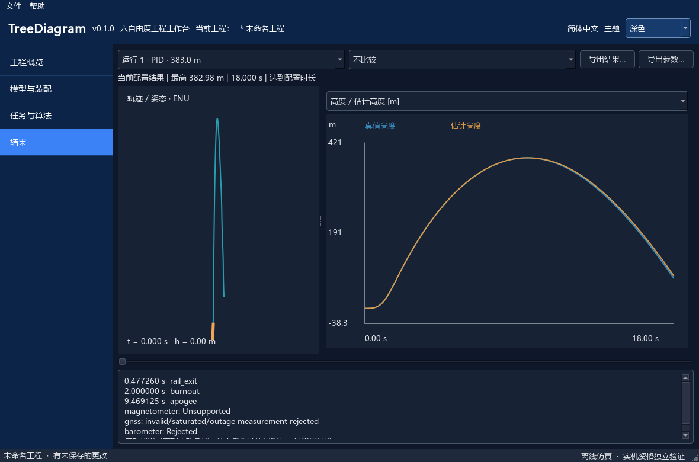

# TreeDiagram

离线六自由度工程桌面工具：零件装配 → 试车推力 → 传感器 → SilverStar 实际 C 估计 / PID / LQR → 物理执行机构 → 结果与参数文件。

当前为单级刚体、小攻角亚声速工程近似。6DoF plant 具有三维平动与转动；演示控制只请求 Body Y 单轴力矩，不提供全包线控制或硬件资格。原 GUI 外壳与工程安全保存功能保留，新增可操作的模型、任务与算法、结果工作区。



上图是实际Qt窗口渲染，使用已完成的合成试车仿真结果，不是设计稿或硬件验证。

## 安装和启动

Python 3.11+，推荐本轮验证的 Python 3.14；本地 GCC 用于实际 C 算法。首次安装需要取得 Python 依赖，安装后示例、仿真和 C 构建均不访问网络。启动时不下载 SilverStar main。

```powershell
python -m venv .venv
.\.venv\Scripts\python.exe -m pip install -r requirements-tested.txt
.\.venv\Scripts\python.exe -m pip install -e ".[test]"
.\.venv\Scripts\python.exe run.py
```

也可双击 `TreeDiagram.cmd`（优先使用项目 `.venv`），或安装后执行 `treediagram`。GCC 必须在 PATH，或设置 `CC` 为本机 GCC 路径。固定源码快照、编译参数和缓存说明见 [实际算法](docs/ALGORITHMS.md)。无控制默认例子不需要 C 编译器。

GUI：进入“模型”→“打开离线示例”；双击零件编辑草稿；进入“任务与算法”选择真实估计器、PID/LQR及执行机构；运行后到“结果”查看轨迹、曲线、误差、事件与诊断。Apply 才提交参数，Cancel/Esc 保留原配置。修改工程后已有结果显示“历史配置”。运行与取消使用后台线程，失败不发布半个结果。

## 命令行和样例

在仓库目录运行（也可用已安装的 `treediagram-cli`，参数不变）：

```powershell
.\.venv\Scripts\python.exe -m treediagram run examples/native.json native.tdrun.json
.\.venv\Scripts\python.exe -m treediagram run examples/pid.json pid.tdrun.json
.\.venv\Scripts\python.exe -m treediagram run examples/lqr.json lqr.tdrun.json
.\.venv\Scripts\python.exe -m treediagram import-motor examples/pid.json tests/fixtures/motor/valid_positive.tdmotor.json motor-design.json
.\.venv\Scripts\python.exe -m treediagram run motor-design.json motor.tdrun.json
.\.venv\Scripts\python.exe -m treediagram export-parameters motor.tdrun.json motor.sstuning.json
.\.venv\Scripts\python.exe -m treediagram import-ork tests/fixtures/single-stage.ork ork-design.json
.\.venv\Scripts\python.exe -m treediagram check ork-design.json
```

ORK 导入是结构子集；缺失的发动机、气动或惯量必须明确补齐。`check` 对结构可读但不可运行的工程返回 2。`tests/fixtures/unknown-component.ork` 是阻断负例。CLI 使用与 GUI 相同的模型、导入器、求解器和导出器。

四种执行机构示例在 `examples/actuators/`；七种估计器示例在 `examples/estimators/`。后者用同时刻量测满足增强核约束；默认 KF6 示范保留 GNSS 延迟。`tools/verify_examples.py OUTPUT_DIRECTORY` 实际运行全部组合、写出概要和参数包。合成试车不是实物精度依据。

Underline 保持原 GUI，从原导出对话框选择 TreeDiagram motor-test 格式；其 CLI 为 `python -m underline_retldc.cli export PROJECT OUTPUT`。SCG 在任务设计页导入 `.sstuning.json`、预览后一次 Apply。控制参数明确为研究用途；已有生成 C 消费者与目标 ARM 构建不等于物理驱动、任务调度及电气闭环已接通。

## 数据和扩展

- [模型、时间、坐标、物理和数据合同](docs/CONTRACTS.md)
- [唯一后端的决定与参考](docs/ADR-001-BACKEND.md)
- [C 算法、调参和目标能力](docs/ALGORITHMS.md)
- [完整中文交付报告与未完成项](docs/DELIVERY_20261101_ZH.md)
- [第三方许可](docs/THIRD_PARTY.md)

`.tdproj` schema 2 保存配置和最多 10 次结果；schema 1 旧外壳工程仍可读取。原子替换、上一版本 `.bak`、外部修改摘要检查与 `.lock` 保留。文件上限 32 MiB；大运行请单独导出再分工程保存。输入只作数据处理，不执行脚本或安装插件。结果/参数导出使用已完成运行的快照；源码身份改变后旧结果不能冒充新内核导出。

## 验证

```powershell
.\.venv\Scripts\python.exe -m pytest -q
.\.venv\Scripts\python.exe tools/verify_examples.py .qa/matrix
.\.venv\Scripts\python.exe tools/preview_gui.py
```

本轮 Windows 桌面与 offscreen 的实际测试、失败历史、源身份和原始输出见 `docs/evidence/20261101/`。未执行的 Linux/macOS 桌面、真实硬件、全程序栈证明和全包线准确性不会从 Host 测试推定为通过。原创代码 Apache-2.0；固定上游来源保留原许可。

Windows完整测试113项通过；后续图例文字改动的GUI组5项通过。首次推送的[Ubuntu核心/合同CI](https://github.com/aleistercrowleybeast666/TreeDiagram/actions/runs/41229254520)实际104项通过，使用干净Git checkout和Python3.13.17；这不代表Linux桌面也已验收。15个真实运行样例与跨仓库143项参数对照见验证索引。
